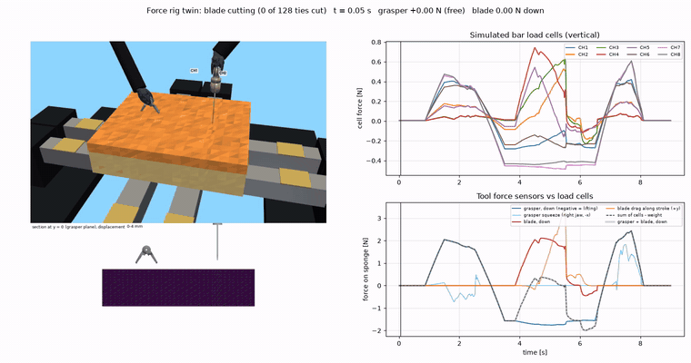

# SOFA force twin: a two-layer sponge on eight load cells

A [SOFA](https://www.sofa-framework.org/) simulation of the lab's surgical force rig: a soft
two-layer sponge glued onto eight bar load cells, pressed, grasped, cut and dissected by da Vinci
instrument tips (a Large Needle Driver grasper and a #11 scalpel). SOFA computes the deformation
(finite elements), the contacts with friction, the cutting, and every force: the eight load-cell
readings and a 6-axis force/torque sensor on each instrument part.

Everything runs headless on Linux from Python. There is no Unity or other renderer here; videos
and plots are drawn with PyVista and matplotlib.

<p align="center"></p>

## Quick start

```bash
git clone https://github.com/AbdullahSohail15/sofa-force-twin.git
cd sofa-force-twin
conda env create -f environment.yml        # SOFA 25.12 + Python 3.12, ~5-10 min, ~4 GB
conda activate sofa-twin

./run.sh 01                                # first scene, ~30 s: outputs/block_on_supports/
```

Then open `outputs/block_on_supports/block_on_supports.mp4` and `forces.png`.
Full installation notes (Miniforge, the SOFA binary alternative, headless rendering, errors):
[docs/installation.md](docs/installation.md).

## Scenes

Each scene is one Python file in `scenes/`. `./run.sh <number>` simulates it, checks it and renders
a video, a force plot and a CSV into `outputs/<scene name>/`.

| # | `./run.sh` | Scene file | What happens | Run time* |
|---|---|---|---|---|
| 01 | `01` / `block` | `block_on_supports.py` | Foam block on 4 spring load cells; an off-centre 1.5 N press is ramped on and off | ~20 s |
| 02 | `02` / `indenter` | `indenter_contact.py` | A rigid 8 mm sphere presses 6 mm in, slides 20 mm with friction, retracts | ~18 min |
| 03 | `03` / `rig` | `rig_indenter.py` | The same indenter on the real rig: two-layer sponge, 8 bar cells | ~32 min |
| 04 | `04` / `tools` | `rig_tools.py` | Grasper pinches and lifts the sponge; scalpel presses and drags (no cutting) | ~12 min |
| 05 | `05` / `cut` | `rig_cut.py` | Grasper holds; scalpel plunges 8 mm and cuts a 20 mm straight line | ~15 min |
| 06 | `06` / `dissect` | `rig_dissect.py` | Grasper lifts a corner of the orange layer; scalpel dissects it off along the layer interface | ~16 min |
| – | – | `examples/basic_press.py` | **Start here to write your own:** a short hard-coded scalpel press-and-drag | ~7 min |

\*Simulation + video, measured from a clean install on one 8-core slice of a shared Xeon server with
SOFA 25.12 (conda). A recent laptop is usually faster. Each scene uses one core, so several can run
in parallel.

Details of every scene (motion, outputs, built-in checks, what to change):
[docs/scenes.md](docs/scenes.md).

## Documentation

| Document | Contents |
|---|---|
| [docs/installation.md](docs/installation.md) | Installing SOFA and the Python packages on Linux; checking the install; common errors |
| [docs/scenes.md](docs/scenes.md) | The six scenes one by one: motion, what is measured, expected numbers |
| [docs/writing_your_own_script.md](docs/writing_your_own_script.md) | Walkthrough of `examples/basic_press.py`: tool paths, materials, mesh, outputs |
| [docs/physics_model.md](docs/physics_model.md) | How the model works: units, frame, FEM, load cells, tools and sensors, grasping, cutting, solvers |
| [docs/outputs.md](docs/outputs.md) | Every file a run writes: `sim.npz` keys, `forces.csv` columns |
| [docs/troubleshooting.md](docs/troubleshooting.md) | SOFA pitfalls we hit and their fixes |

## Repository layout

```
run.sh                 run a scene: simulate -> balance check -> video + plot + CSV
environment.yml        conda environment (SOFA 25.12, Python 3.12)
scenes/                SOFA scenes and the shared model code
  rig.py                 rig geometry: sponge, layers, the eight load cells, mesh
  tools.py               instrument meshes (dVRK grasper, scalpel), rotations, wrist kinematics
  rig_tools.py           scene 04 + the shared tool machinery (sensors, grasp, recorder)
  cutting.py             zero-width cutting by releasing tie springs
  block_on_supports.py, indenter_contact.py, rig_indenter.py, rig_cut.py, rig_dissect.py
examples/basic_press.py  minimal hard-coded script to copy
scripts/               rendering, force export and checks (no SOFA needed except where noted)
  render_video.py, render_indenter.py, render_rig.py, render_tools.py   videos + plots + CSV
  check_balance.py       force and moment balance of a tool run
  compare_runs.py        compare two runs of the same scene (e.g. two machines)
  wrench.py              6-axis wrench per instrument (world and tool frame)
  prepare_dvrk_tools.py, make_scalpel.py   regenerate assets/ (not needed to run)
assets/                instrument meshes (dvrk_tools.npz, scalpel.npz) + dVRK licence
docs/                  documentation
```

## Status and limits

- Rig dimensions were measured from photos and the foam moduli (30 and 60 kPa), friction and cutting
  resistance are guesses. They are not yet calibrated against the real load cells.
- The load-cell channel order CH1–CH8 is our own numbering (clockwise from the top-left in the
  overhead view), not yet mapped to the real amplifier channels.
- Cuts follow a plane fixed when the mesh is built (scenes 05, 06); the blade cannot steer freely.
- Simulation is far slower than real time (about 75–100× for the tool scenes, ~0.7–1 s per 10 ms step).

## Credits and licences

- Code: MIT licence, see [LICENSE](LICENSE).
- Instrument meshes in `assets/dvrk_tools.npz` are converted from the
  [da Vinci Research Kit model](https://github.com/jhu-dvrk/dvrk_model) (MIT, see
  [assets/DVRK_LICENSE](assets/DVRK_LICENSE)). The scalpel is generated by `scripts/make_scalpel.py`.
- SOFA is LGPL and is installed separately; it is not redistributed here.
