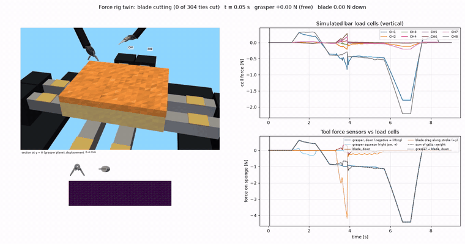

# The scenes

Six scenes, from a simple block to the full rig with cutting. Each builds on the previous one, so
reading them in order is the best way into the code. Run any of them with `./run.sh <number>`;
outputs go to `outputs/<scene name>/` (see [outputs.md](outputs.md)).

The numbers below come from a clean install (`conda env create -f environment.yml`, SOFA 25.12)
on one 8-core slice of a Xeon server, November 2026. Each scene uses one core.

| # | Scene | Simulated | Simulation time | + video | Mesh |
|---|---|---|---|---|---|
| 01 | Block on four supports | 6 s | 15 s | 20 s | 605 nodes, 2400 tets |
| 02 | Sphere indenter on the block | 8.5 s | 17 min | 30 s | 3969 nodes, 19 200 tets |
| 03 | Sphere indenter on the rig | 8.5 s | 31 min | 1.3 min | 2432 nodes, 11 340 tets |
| 04 | Grasper + scalpel on the rig | 9 s | 11 min | 1.3 min | 2432 nodes, 11 340 tets |
| 05 | Straight cut | 9 s | 13.5 min | 1.3 min | 2688 nodes, 11 970 tets, 128 ties |
| 06 | Layer dissection | 9 s | 15 min | 1.3 min | 2736 nodes, 11 340 tets, 304 ties |
| – | `examples/basic_press.py` | 5.5 s | 7 min | – | 2432 nodes, 11 340 tets |

---

## 01: foam block on four load cells (`scenes/block_on_supports.py`)

```bash
./run.sh 01        # -> outputs/block_on_supports/
```

A 100 × 100 × 40 mm foam block (E = 30 kPa, ν = 0.3, 30 kg/m³, 12 g) rests on four square
support patches (25 mm) at (±35, ±35) mm. Each support is a 5e4 N/m spring on its 4 bottom nodes;
the spring force is the load-cell reading. No contact: the load is a prescribed force on the top
nodes within 11 mm of (20, 10) mm.

| Time | Phase |
|---|---|
| 0–1 s | settle under gravity |
| 1–2.5 s | ramp the press to 1.5 N |
| 2.5–4 s | hold |
| 4–5 s | release |
| 5–6 s | rest |

**Check:** at rest the four cells sum to the weight m·g = 0.1177 N; during the hold they sum to
0.1177 + 1.5 N (measured 1.617 N). The off-centre press loads the cell nearest to it most
(0.14 / 0.45 / 0.79 / 0.24 N). The video exaggerates displacements 5×
(`render_video.py --exaggerate`).

**Read this scene first:** it is the smallest complete SOFA scene in the repo (~200 lines):
mesh, FEM, mass, springs as sensors, a Python controller that applies the load and records.

---

## 02: rigid sphere indenter with friction (`scenes/indenter_contact.py`)

```bash
./run.sh 02        # -> outputs/indenter_contact/
```

The same block on a finer 5 mm mesh. An 8 mm radius sphere presses 6 mm into the top at (20, 10)
mm, holds, slides 20 mm in −x, holds, and retracts. Contact uses Lagrange multipliers with Coulomb
friction μ = 0.3 against the block's surface triangles.

The sphere is a 2 g body on a 1e4 N/m spring to a kinematic target that follows the path. **That
spring is the tool force sensor**, measured independently of the four load cells. This
"position-controlled body on a sensor spring" pattern is what all the instruments in scenes 03–06
use.

| Time | Phase |
|---|---|
| 0–0.5 s | settle (4 mm above the surface) |
| 0.5–2.5 s | press 6 mm |
| 2.5–3.5 s | hold |
| 3.5–5.5 s | slide 20 mm in −x |
| 5.5–6.5 s | hold |
| 6.5–8.0 s | retract |

**Check:** at every hold the tool force equals the sum of the cells minus the weight, vertically
and laterally (at t = 6 s: tool −0.703 / −1.905 N vs cells +0.711 / +1.906 N). While moving the
tool reads a little more than the cells (the block's internal damping). During the slide the
lateral/normal ratio (~0.4–0.5) exceeds μ = 0.3 because the deep sphere also ploughs the foam.

---

## 03: indenter on the real rig (`scenes/rig_indenter.py`)

```bash
./run.sh 03        # -> outputs/rig_indenter/
```

The scene-02 indenter on the lab rig (`rig.py`): the 86 × 71 × 21 mm sponge with a 15 mm cream
base (30 kPa) under a 6 mm orange scrub layer (60 kPa), on eight bar load cells CH1–CH8. Here each
cell is a vertical spring under the sponge nodes over its bar tip (the per-node "springs" model).
The sphere starts at (15, 8) mm, presses 6 mm, slides 30 mm in −x and retracts.

**Check:** at every hold the tool force equals the sum of the cells minus the weight
(at t = 3 s the sphere pushes 2.065 N down and the cells minus the weight read 2.065 N;
at t = 6 s, 2.053 vs 2.053 N, with 0.69 N of lateral drag). The video shows the rig in its real colours with labelled cells and a section
through the tool path.

---

## 04: grasper and scalpel on the rig (`scenes/rig_tools.py`)

```bash
./run.sh 04        # -> outputs/rig_tools/
```

The full rig with two instruments (see [physics_model.md](physics_model.md)):

- **Grasper** (dVRK Large Needle Driver jaws), pivot over (−18, 0) mm.
- **Scalpel** (#11 blade, called `blade` in the data), upright, cutting edge facing +y.
- Load cells as rigid plates glued to the sponge (`rig.CELL_MODEL = "plate"`). Friction μ = 1.

| Time | Grasper | Scalpel |
|---|---|---|
| 0–0.5 s | open, 3 mm above the top (settle) | 5 mm above (22, −8) mm |
| 0.5–1.5 s | open tips press 5 mm into the foam | |
| 1.5–2.5 s | jaws close; at 2.5 s the nodes between them are attached | |
| 2.5–3.5 s | lift to 4 mm above the top | |
| 3.5–4.3 s | hold | press the point 3 mm in |
| 4.3–6.0 s | hold | drag 16 mm along +y (no cutting in this scene) |
| 6.0–6.6 s | hold | retract |
| 6.5–7.2 s | lower to 6 mm into the foam, release at 7.2 s | |
| 7.2–9.0 s | open, retract | |

Peak forces on the sponge: grasper pushes down 2.4 N while closing and lifts with 1.7 N; the
scalpel pushes down 1.2 N and drags with up to 1.4 N. Cells range from −0.47 N (pulled up: the
sponge is glued to the cells) to +0.61 N.

**Check** (`scripts/check_balance.py`, run by `run.sh`): vertical force balance median 0.6 µN,
worst 14 mN (single steps where a motion starts or stops); moment balance median 0.49 N·mm,
worst 2.5 N·mm against tool moments up to 50 N·mm.

**To change:** the grasper plan (`GRASP_XY`, `GRASP_PATH`, `T_GRASP`, `T_RELEASE`), the scalpel path
(`BLADE_PATH`: time, x, y, height of the point above the top), `FRICTION`, and the sensor/grasp
stiffnesses at the top of the file.

---

## 05: straight cut (`scenes/rig_cut.py`)

```bash
./run.sh 05        # -> outputs/rig_cut/
```

Scene 04's grasper plan; the scalpel cuts instead of dragging. The sponge mesh is **split along the
plane x = 22 mm** (`CUT_X`) and the two sides are held by 128 tie springs; the scalpel releases the
ties it pushes through (`scenes/cutting.py`, `F_CUT = 0.8` N). There is no kerf: the faces part
around the blade and close behind it.

| Time | Scalpel (the grasper does as in scene 04) |
|---|---|
| 0–3.5 s | wait 5 mm above (22, −10) mm |
| 3.5–4.5 s | plunge 8 mm, through the 6 mm scrub layer |
| 4.5–6.0 s | slice 20 mm along +y |
| 6.0–6.8 s | pull out through the cut |

**What happens in the current model:** 18 of the 128 ties are cut, between 4.1 and 5.5 s, over
y = −12 … +7 mm and down to z ≈ 12 mm (9 mm deep). The tie spacing is one mesh cell (4.7 mm along
y, 3 mm in z), so the cut advances in steps: the blade's drag builds up to ~3.4 N before the next
column of ties releases, then drops. Peak downward scalpel force 2.1 N.

**Check:** force balance median 2.5 µN, worst 14 mN; moment balance worst 3.6 N·mm against tool
moments up to 60 N·mm.

**To change:** `CUT_X` (must be a plane the mesh can be split along; `rig.make_sponge(cut_x)`
inserts a node plane there), `BLADE_PATH`, and the cutting parameters on `TieCutRecorder`
(`f_cut`, `radius`, `reach`).

---

## 06: dissecting the scrub layer off the foam (`scenes/rig_dissect.py`)

```bash
./run.sh 06        # -> outputs/rig_dissect/
```

<p align="center"></p>

The grasper pinches the orange scrub layer near the top-left corner and lifts it. The scalpel, held
**flat in the layer interface**, goes in point first from the sponge's top edge, then sweeps
sideways with its cutting edge leading, under the lifted flap and out through the left edge. The
grasper lifts the freed flap, lays it back down and lets go.

Cutting is the same tie release, on the split plane **z = 15 mm** (the layer interface, 304 ties),
with a lower resistance `F_CUT = 0.15` N (peeling a bonded interface takes far less than cutting
through foam). Only the scrub layer's top nodes can be grasped.

| Time | Grasper (pivot over (−35.8, 28.4) mm) | Scalpel |
|---|---|---|
| 0–1.5 s | open tips 2 mm into the scrub layer | waits above the top edge |
| 1.5–2.3 s | close; attach at 2.3 s | |
| 2.3–3.0 s | lift 3 mm (tension on the corner) | moves to the interface height |
| 3.0–3.9 s | hold | goes in point first along −y |
| 3.9–5.7 s | hold gently | sweeps along −x, under the flap, out of the left edge |
| 5.7–6.6 s | lift the freed flap to 14 mm | withdraws |
| 6.6–8.3 s | lay it back down, release at 7.8 s, open | |

**Result:** 38 of 304 ties cut (3.3–5.1 s); the grasper lifts the flap with up to 4.4 N; the two
cells under that corner (CH1, CH8) read down to −2.2 N (pulled up).

**Check:** force balance median 1.2 µN, worst 24 mN (at the flap lift/lay-down); moment balance
worst 8.7 N·mm against tool moments up to 60 N·mm.

**Limits** (05 and 06): cuts follow the pre-built plane only; the two cut faces do not collide with
each other, so where the flap is laid back down it can sink into the foam slightly; `F_CUT` values
are guesses.

---

## `examples/basic_press.py`

```bash
python examples/basic_press.py --out outputs/basic_press      # after: export SOFA_ROOT=$CONDA_PREFIX
```

The minimal script to copy: the grasper parked, the scalpel pressed 3 mm in at (10, −10) mm,
dragged 12 mm along +y, lifted out. Peak downward force 0.92 N; dragging without cutting, the blade
ploughs the foam with up to 2.3 N. Force balance worst 5 mN. See
[writing_your_own_script.md](writing_your_own_script.md).
